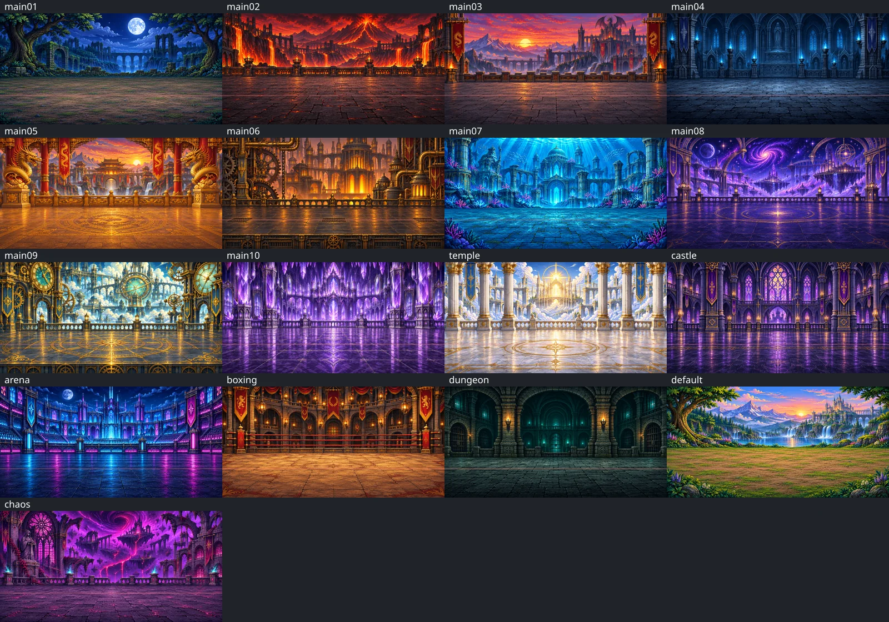
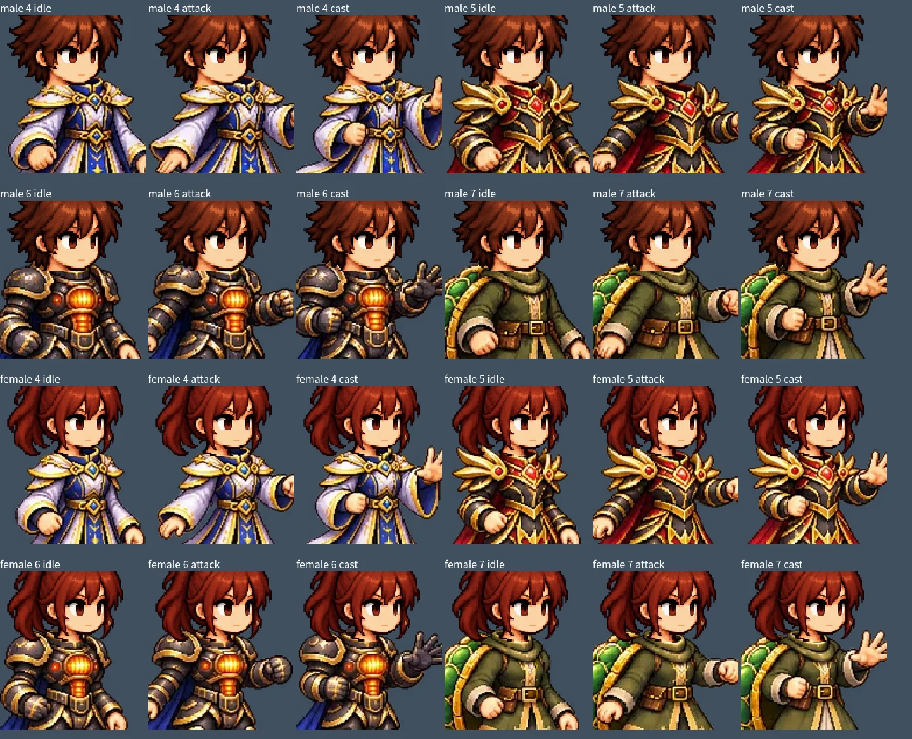

# 桌面場景、素材分類與混搭接合修正（456）

## 問題與修改

舊戰鬥場景中 16 張只有 768×512，另一張為 1536×1024；桌面放大後背景還受到共用特效畫布解析度上限影響。本次重繪 17 個主線及模式場景，每張原生 1774×887，存為 WebP q85。桌面使用獨立、只在載入／尺寸／場景變更時重畫的背景層，沒有增加逐幀特效畫布預算。圖片的 74% 高度對齊共用角色及陰影的地面座標，等比例填滿畫面，沒有拉伸地板。手機沿用原圖，桌面圖失敗也會退回原圖。

新防具為無頭身體，舊頭部圖包含頸部，新頭部圖則截止於下顎；之前共用零偏移疊圖產生接合差異。本次在共用合成器校正新舊混搭的下顎高度，並讓新防具領口遮蓋多餘舊頸部。男女與待機／攻擊／施法共用處理；腳底、武器持握點與能力數值不變。

素材依 [分類說明](../ASSETS.md) 整理。224 份內嵌 WebP 原位元組抽出，723 個既有公開資源保留內容，另新增 17 張桌面背景；合計 964 個資源（947 圖片及 17 音訊）。保留 1,608 筆解析對照與 748 個公開舊網址的單次 301。HTML 約從 26.2 MB 降到 5.65 MB。歷史素材也完整保留；沒有依使用頻率刪除。

## 已驗證

- `python tools/audit_assets.py`：964 資源、0 缺失、0 相同檔案群組，轉址無鏈／循環。
- `node tools/check_assets456.cjs`：964 個內容雜湊、947 張瀏覽器圖片解碼、4,419 個路徑／前綴／查詢參數測例通過。
- 與搬移前執行期快照比對，591 個角色／敵人／裝備等 art key 的圖片位元組一致；目前公開企劃中的 24 個寵物路徑都能解析。
- `node tools/check_scenes456.cjs`：17 場景 × 5 桌面尺寸共 85 組通過（1024×768、1280×720、1920×1080、2560×1440、3440×1440）。檢查角色共用地面、背景覆蓋、無橫向溢出、畫布預算、同場重繪保留畫布、載入失敗降級、手機切換清理與手機不下載桌面圖。另驗證 1920×1080 DPR 2 分離畫布預算。
- `node tools/check_avatar454.cjs`：384 組男女／頭部／防具／姿勢合成、42 種武器、+10 形象、E／F／魔法彈實際共用技能流程與傷害結果、手機導覽隱藏、減少動態、鏡像與缺圖降級通過。
- `node tools/check_relic455.cjs`：手機直橫向及桌面，遺物預覽、重套樣式、整備、取消、存取、恢復、推進、營地與撤退通過。
- 整備切換性別與重繪保留畫布，抽樣沒有空白幀；主線／遺物 5 種桌面尺寸無整備捲動及控制列重疊。
- `python tools/package_site.py`：968 個公開檔案，單檔低於 Pages 25 MiB；測試、來源與審查文件不公開。

瀏覽器驗證採 Linux Chromium 與合成狀態、阻擋外部 API；沒有以玩家帳號進行正式交易，也未聲稱實體 iPhone／Safari 測試。沒有修改後端、企劃數值、授權或玩家資料。
